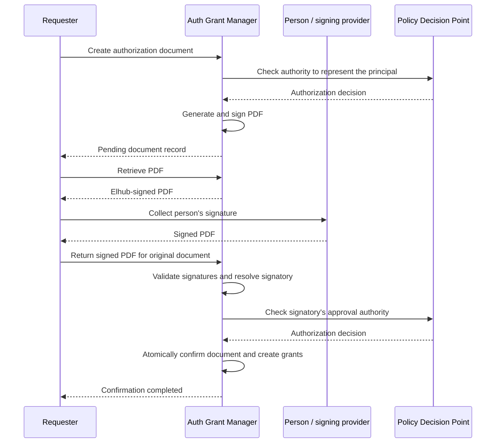

# Authorization document

## Purpose

Collect authorization through a signed PDF instead of an electronic request
decision. The requester arranges signature collection outside this service.

## Preconditions

The requester identifies the authorization type, the principal, the party
asked to authorize, and the document language. The service validates the
inputs for that type and checks that the party asked to authorize can
represent the principal.

## Sequence

Only the original requester (`requestedBy`) can submit the signed PDF.
The signatory, not the uploader, is recorded as `approvedBy`.

## Verification and exceptions

The current signature implementation checks the Elhub signature and original
document correspondence, disallowed revisions between signatures, and a
BankID signature with trusted certificate roots, timestamp, and long-term
validation material. It extracts the signer's Norwegian national identity
number and resolves the person before checking approval authority.

These are implementation checks, not a blanket claim of legal compliance or
support for every electronic-signature provider. The existing usage page
describes signing requirements separately.

The upload must be a nonempty PDF of at most 1 MiB (1,048,576 bytes).
Wrong uploader, unsupported content, failed signature verification,
unresolvable or unauthorized signatory, expired proposal, invalid grant
validity, and an already confirmed document prevent successful confirmation.
No grants are committed for a failed confirmation.

## Outcome

The confirmed document becomes `Approved`; the signed PDF and approver are
stored together with the resulting grants in one transaction. Retrieving the
PDF afterwards returns the stored signed file.

There is no document rejection operation in v1. A document that is never
successfully confirmed becomes `Expired` at its deadline. A failed upload is
not a recorded rejection.

## Implementation references

* [Creation](../../src/main/kotlin/no/elhub/auth/v1/features/documents/CreateDocumentHandler.kt)
* [Confirmation](../../src/main/kotlin/no/elhub/auth/v1/features/documents/ConfirmDocumentHandler.kt)
* [Signature verification](../../src/main/kotlin/no/elhub/auth/common/documents/pdf/ITextPdfSignatureService.kt)
* [Atomic confirmation persistence](../../src/main/kotlin/no/elhub/auth/v1/repositories/DocumentRepository.kt)
