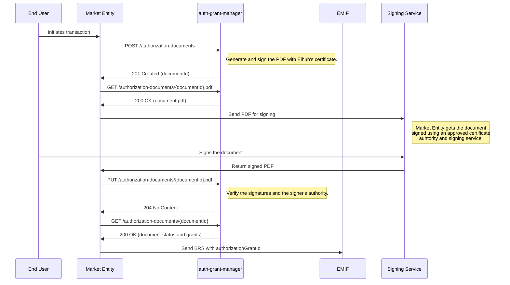

# Authorization document

## Purpose

Collect approval through a signed PDF. The market entity arranges signing outside Elhub and returns the signed
document for verification.

## Preconditions

* The requester (`requestedBy`) is a market entity with a valid Elhub role that allows it to request the authorization type.
* The party asked to authorize (`requestedOf`) can represent the principal (`requestedPrincipal`).
* The person signing the document has authority to approve the authorization.

## Sequence

The market entity creates an authorization document in Elhub and uses its ID to retrieve the Elhub-signed PDF.
The end user signs it through a signing provider. Only the original requester can return the signed PDF.
Elhub checks that it matches the original document, verifies the signatures, and confirms that the signer
has authority to approve. The market entity can then retrieve the document status and the resulting grant IDs
for use in Elhub.

## Outcome

On successful confirmation, the system stores the signed PDF, records the signer as `approvedBy`, and creates the
grants defined by the authorization type in the same transaction. A failed confirmation creates no grants. The
document has no rejection operation and expires if it is not confirmed by its deadline.

## Related Resources

* [AuthorizationDocument](../resources/authorization-document.md)
