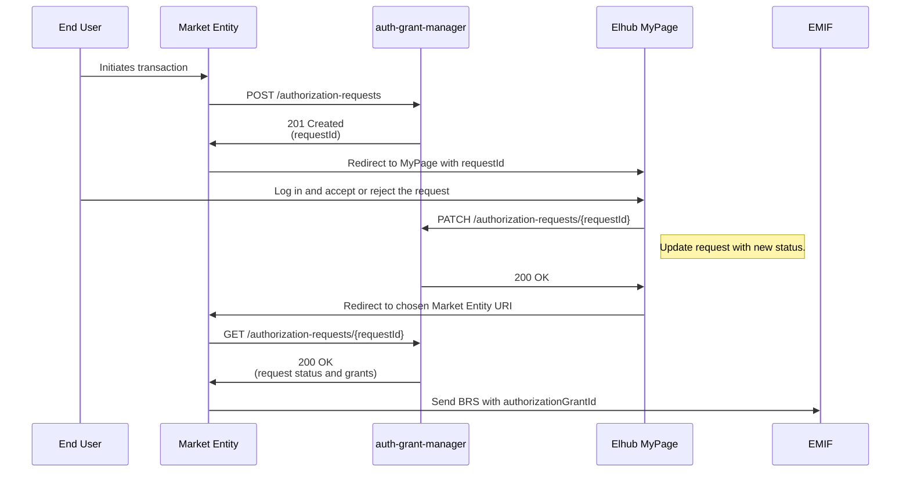

# Authorization request

## Purpose

Collect an electronic approval or rejection from a person with authority to decide. The approval is collected through Elhub MyPage.

## Preconditions

* The requester (requestedBy) is a market entity with a valid Elhub role that allows it to request the authorization type.
* The principal (requestedPrincipal) is an agent that has the authority to approve or reject the request.

## Sequence

The market entity creates an authorization request in Elhub. Using the ID of the request, the market entity can then
redirect the end user to Elhub MyPage, where the end user can log in and approve or reject the request. The end user
can also log in to MyPage directly to see any pending requests. After the end user makes a decision, the market
entity can retrieve the updated request status and any resulting grants. The market entity can then use the grant ID
to carry out  relevant actions in the Elhub system, such as sending a BRS message to EMIF.

## Outcome

If an authorization request is approved, the system records the decision, the signatory as `approvedBy`, and creates
the grants defined by the authorization type in the same transaction. If the request is rejected, the system records
the decision language and creates no grants. A request can only be decided once; concurrent or repeated decisions
cannot create a second set of grants.

## Related Resources

* [AuthorizationRequest](../resources/authorization-request.md)
