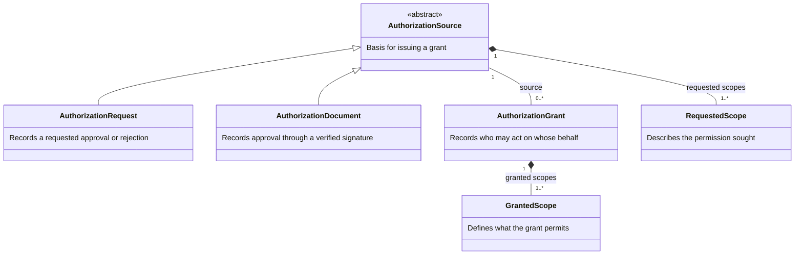

# Resources

This section describes the business resources in `auth-grant-manager` and
their relationships.

`AuthorizationSource` is the superclass of `AuthorizationRequest` and `AuthorizationDocument`; it is not a separate
API resource. [Requested and granted scopes](../concepts/authorization-scopes.md)
are embedded objects, not standalone resources.

| Resource                                            | Role                                                         |
|-----------------------------------------------------|--------------------------------------------------------------|
| [Authorization request](authorization-request.md)   | Electronic proposal and decision.                            |
| [Authorization document](authorization-document.md) | Generated PDF and verified signature evidence.               |
| [Authorization grant](authorization-grant.md)       | Permission produced by an approved source.                   |
